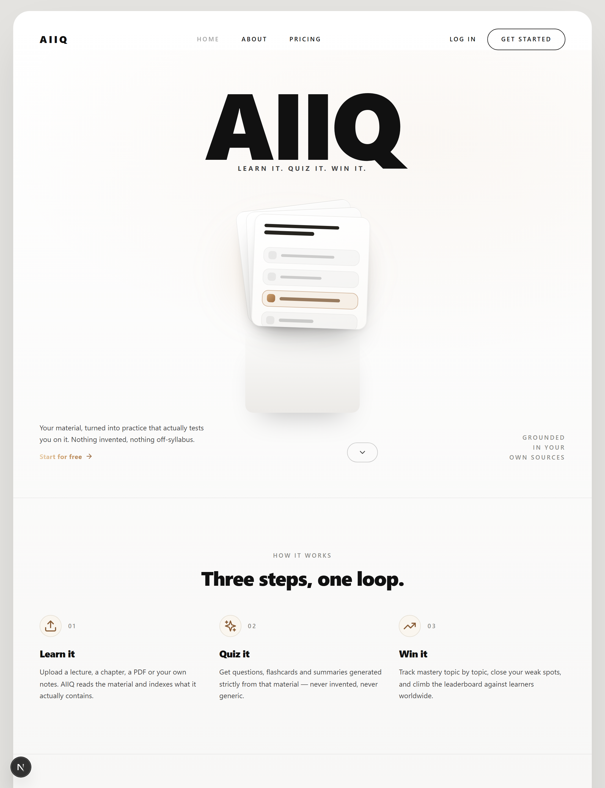
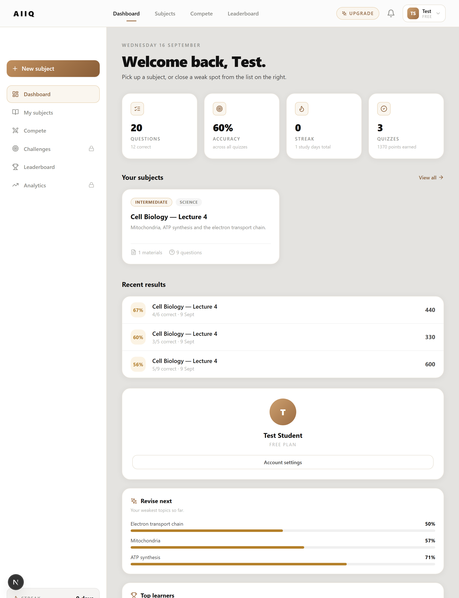
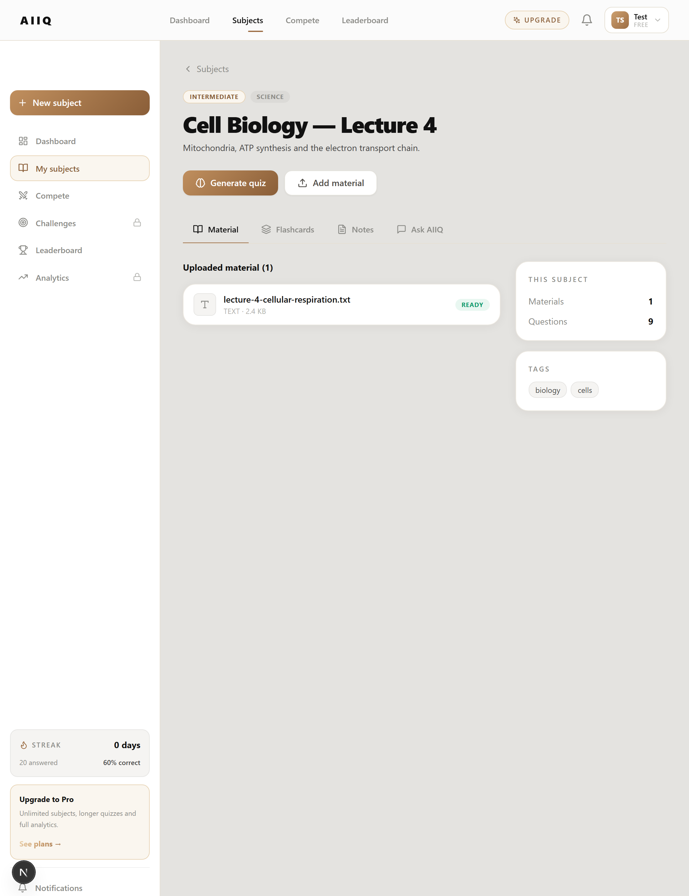
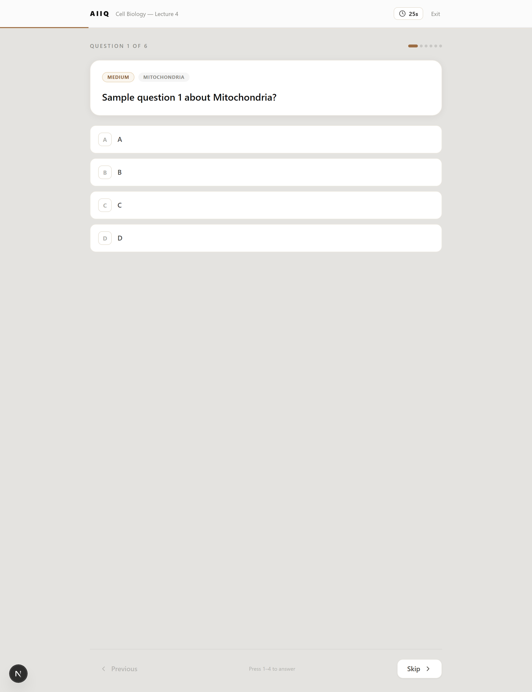
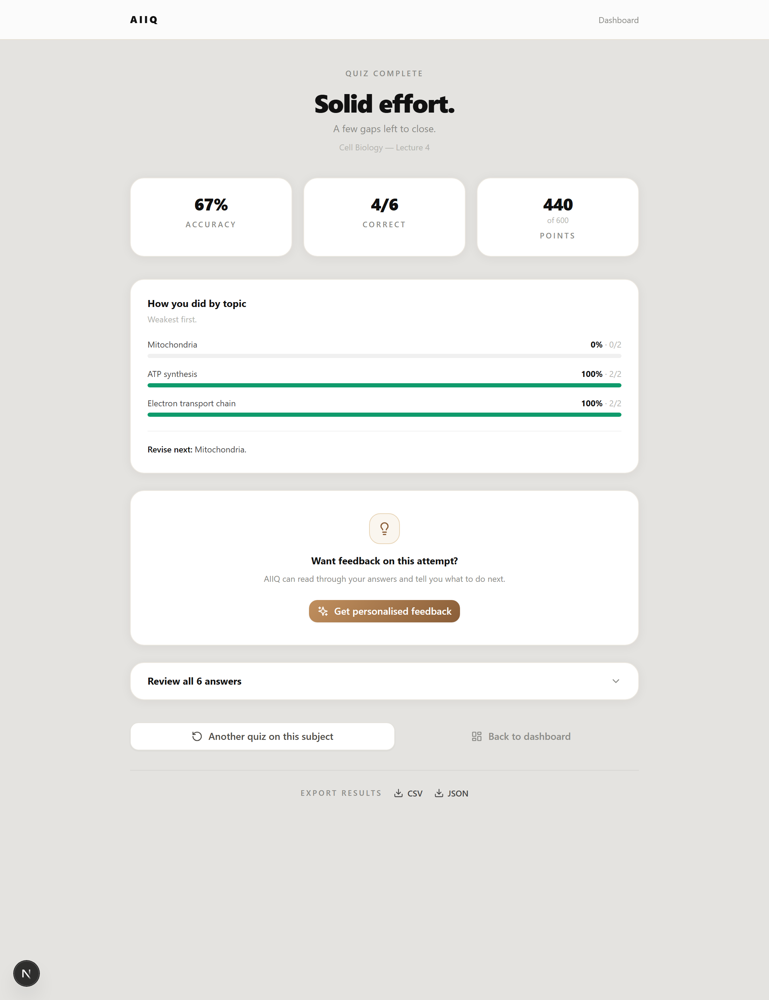

# AIIQ: AI-Powered Study & Quiz Platform

AIIQ turns a student's own study material into an interactive learning workspace. Upload lecture notes, slides or a textbook chapter and AIIQ generates quizzes, flashcards, study notes and summaries grounded **only in that material**, then adapts feedback to the topics the student is weakest on.

> 🏆 Semi-finalist, **WYBI: Pathway to Success** startup competition
> 🎓 Developed as my **MSc Data Science dissertation** at Middlesex University London



---

## Features

- **Document ingestion:** PDF, DOCX, PPTX, TXT and images (OCR via a vision model) are extracted to clean text before it reaches the model
- **AI quiz generation:** multiple choice, true/false, fill-in-the-blank and short-answer questions with explanations, difficulty levels and topic tags
- **Duplicate control:** every question is fingerprinted so regenerated quizzes don't repeat themselves
- **Flashcards, key concepts, study notes and document summaries** generated from the same source text
- **Adaptive feedback:** after each attempt the model identifies weak topics and recommends what to study next
- **Ask your notes:** a chat panel that answers questions using the uploaded material
- **Live quiz rooms:** real-time multiplayer quizzes over WebSockets, with a global leaderboard and challenges
- **Export results** as JSON or CSV
- **Accounts and plans:** JWT auth with refresh tokens, password reset by email, Stripe subscriptions, rate limiting

## Screenshots

| Dashboard | Study workspace |
|---|---|
|  |  |
| **Quiz** | **Results** |
|  |  |

## How it works

```
Upload (PDF / DOCX / PPTX / TXT / image)
        │
        ▼
Text extraction (pdf-parse, mammoth, JSZip, vision OCR) → cleaning → length cap
        │
        ▼
LLM generation (Google Gemini 2.5 Flash, structured JSON output)
        │      quizzes · flashcards · key concepts · notes · summaries
        ▼
Validation + fingerprinting → PostgreSQL (Prisma, 28 models)
        │
        ▼
Quiz sessions → scoring → adaptive narration on weak topics → leaderboard
```

The model is instructed to stay grounded in the uploaded text, return strict JSON, and attach a topic tag and difficulty to every question so results can be analysed per topic.

## Tech stack

| Layer | Technology |
|---|---|
| Frontend | Next.js 15 (App Router), React 18, TypeScript, Tailwind CSS, Radix UI, Framer Motion, TanStack Query |
| Backend | Next.js API routes, custom Node server, Socket.io |
| AI | Google Gemini 2.5 Flash (`@google/genai`), configurable model via env |
| Data | PostgreSQL, Prisma ORM, Redis |
| Auth & payments | JWT (jose), bcrypt, Nodemailer, Stripe |
| Infra | Docker Compose for local Postgres + Redis |

## Run locally

```bash
git clone https://github.com/Alok-Yadav-21/Aiiq.git
cd Aiiq
npm install

docker-compose up -d          # PostgreSQL + Redis
cp .env.example .env.local    # then fill in the values
npx prisma db push

npm run dev                   # http://localhost:3000
```

Set `GEMINI_API_KEY` (or `GOOGLE_API_KEY`) in `.env.local` to enable AI generation. See [SETUP.md](SETUP.md) for the full configuration reference.

## Project structure

```
app/          Next.js routes: marketing pages, auth, dashboard, quiz, API
components/   UI system, layout, subject workspace (flashcards, notes, ask panel)
lib/          ai.ts (LLM layer), extract.ts (document parsing), auth, stripe, prisma, rate limiting
server/       Socket.io server for live quiz rooms
prisma/       Database schema and seed
poster/       Dissertation poster and screenshots
```

## Author

**Alok Yadav** · AI/ML Engineer · MSc Data Science, Middlesex University London

[Portfolio](https://alok-portfolio-lyart.vercel.app) · [LinkedIn](https://www.linkedin.com/in/yadavalokml) · [GitHub](https://github.com/Alok-Yadav-21)
